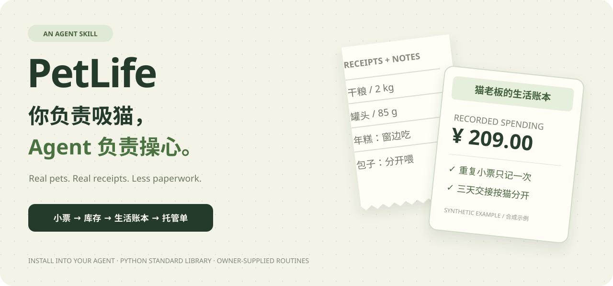

<p align="center"></p>

# PetLife 🐾 你负责吸猫，Agent 负责操心

**把粮袋、小票和“它平时就是这么吃的”交给 Agent。拿回一份算得清、交代得明白的宠物生活账本。** 猫咪和狗狗都可以。

[English](README.en.md) · [看看 Agent 到底会做什么](examples/agent-example.md) · [Skill 本体](SKILL.md) · [生活账本示例](examples/brief.md) · [托管单示例](examples/care-card.md)


## 行李箱关上了，朋友突然问：两只猫到底怎么喂？

你翻开聊天记录：

“年糕在窗边吃，包子得关门喂，不然它会抢。”  
“干粮一只50克，一只40克，罐头每天各半罐。”  
“等等……家里还剩多少罐？那张小票是不是已经记过了？”

**养宠的琐事，通常散落在粮袋背面、购物截图和几句语音里。** PetLife 给 Agent 一套处理这些碎片的方法：读资料、认清是哪只宠物/哪袋粮、核对单位、算账，再把结果整理成人能直接用的说明。

你不用先填一张复杂的表。先把现有资料给 Agent，说清楚想解决什么就行。

## 先试这一句话

```sh
npx skills add l422145205-source/pet-life
```

安装后，对你的 Agent 说：

> 用 `$pet-life` 整理这些粮袋标签、小票和我的日常说明。两只猫共用一袋粮，算一下还够吃多久、本月记了多少钱，再准备3天托管交接单。最后那张小票看不清，别猜。

它会按当前任务整理事实，再调用内置工具核算。照片读取由宿主 Agent 提供；宿主不能读图时，提供标签文字也能用。PetLife 的计算工具只需要 **Python 3.10+ 标准库**，不需要额外部署模型、数据库或服务。

## 让 Agent 接手这三种“铲屎官脑内小剧场”

### ① “明明刚买的粮，怎么又快没了？”

一袋粮、两只猫、不同日用量。PetLife 合并计算共用库存，照顾要求仍按宠物分开。

| 你给它什么 | 它帮你算清什么 |
| --- | --- |
| 标签上的净含量、热量单位 | 一袋/一罐到底有多少，`kcal/kg` 与 `kcal/罐` 怎么换算 |
| 实付小票，而非划线原价 | 每100g或每100 kcal花多少钱，涨价到底涨了多少 |
| 某天盘点的余量、后来买了/用了多少 | 账面还剩多少；按主人现有用量，约够几天 |

一张小票发了两次，只记一次。毫升不偷换成克，模糊价格不编成一个“看起来合理”的数。

### ② “出门三天，别让朋友靠猜。”

PetLife 把“平时怎么照顾”整理成按宠物分开的交接单：

> **年糕**：每天50g干粮、半罐湿粮；在窗边小碗吃，不换碗。  
> **包子**：每天40g干粮、半罐湿粮；书房关门喂，防止抢食。  
> **三天共准备**：270g干粮、3罐湿粮。  
> **还没交代的事**：紧急联系人和处理安排——交接单保持草稿，等主人补齐。

以上来自合成主人说明。它是既定安排的整理和打包量换算，不是为宠物制定新食谱。

### ③ “这个月，究竟是谁在养谁？”

让 Agent 用一点猫老板的口吻，做一份有依据的生活月报：

> **年糕 & 包子的人类财务审计**  
> 本期已记录209元：口粮164元，洗护45元。  
> 重复报销的小票已退回1张；看不清的单据1张，留待核对。  
> 罐头账面约够7天。请人类员工关注库存。  
> 本月互动记录：年糕有一次15分钟逗猫棒记录。没记的事，不替主人编故事。

语气可以有戏，数字要有出处。实际购买支出和“按最近价格估算每天花多少”会分开，避免把囤货支出当成一天的饭钱。

## 从原始资料，到可复现的结果

上面的宠物、品牌和记录都为**合成示例**。对应的资料和实际计算产物全部放在仓库里，可以自己核对：

**[原始资料包](assets/source-packet.example.md) → [结构化记录](assets/household.example.json) → [生活账本](examples/brief.md) / [托管单](examples/care-card.md)**

示例里还有重复小票、未确认付款、未来日期记录。核算结果为209元支出、干粮约25.7天、罐头7天；按既定用量估算合计13.22元/天。

想直接跑计算工具？克隆仓库后执行：

```sh
python scripts/petlife.py build --input assets/household.example.json --as-of 2026-10-03 --trip-days 3 --out work/example
```

得到 `brief.md`、`care-card.md` 和 `report.json`。工具不自带 OCR，输入是 Agent 核对后的结构化事实。[完整过程与更多说法](examples/agent-example.md)

## 下一次，还可以这样使唤它

- “同一张罐头小票我可能发了两遍，更新本地账本，别重复算。”
- “新旧包装不是一个重量，按每100g实付价比较，别只看整袋便宜。”
- “把这周的照顾说明整理成我朋友手机上能看懂的交接单，缺的事放最前面。”
- “给我一份猫老板口吻的月报，可以幽默，但没记录的活动和消费别编。”

## 账本怎么留，哪些地方不会替你猜？

记录保存在选定的本地工作区，计算脚本不联网、不修改输入文件，也不自动给朋友发消息。宿主 Agent 自身的数据处理方式取决于你使用的服务。不要把真实住址、联系方式或原始小票放进公开 Issue；演示可用脱敏或合成资料。

库存是“盘点 + 已记入库 − 已记消耗”的账面数，漏记会高估余量。没有日用量就不猜天数；喂养和用药采用主人明确提供的安排，不用花费分析替代兽医判断。[记录与计算规则](references/record-format.md) · [标签依据](references/labels-and-care.md)

## 给下一个铲屎官留个路标

有让你头大的养宠琐事？欢迎带一份脱敏例子来 [Issues](https://github.com/l422145205-source/pet-life/issues)。如果它替你少翻了几次聊天记录，点个 **Star**，让更多养宠的人和 Agent 找到这里。

MIT 开源。运行检查：`python -m unittest discover -s tests -v`。
