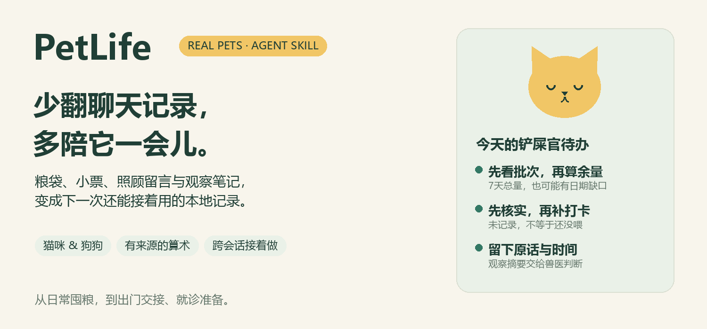
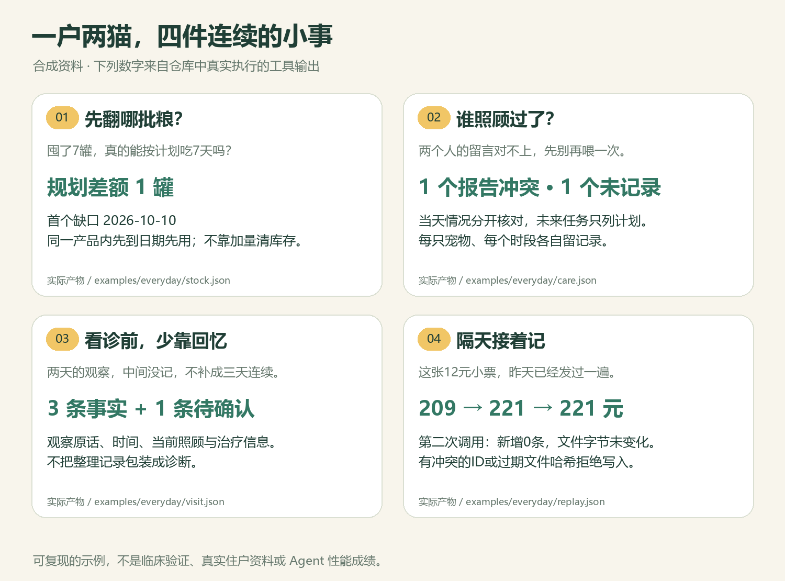
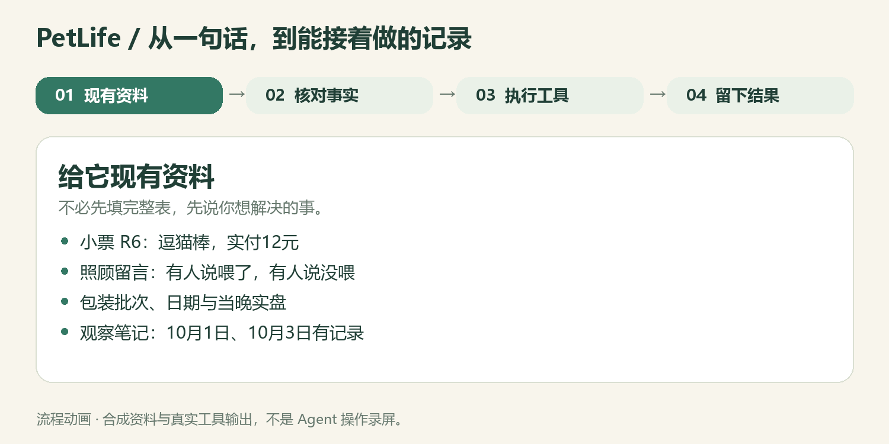
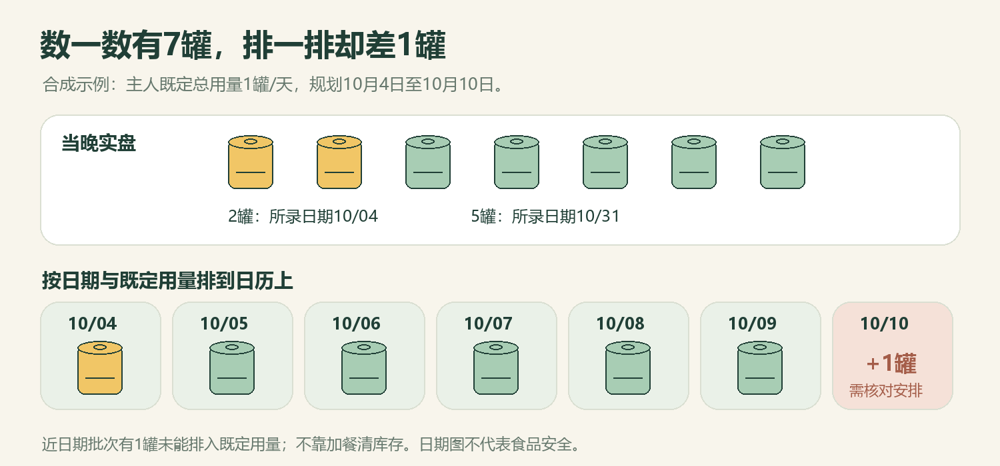

<p align="center"></p>

# PetLife 🐾 铲屎官生活管家

**“谁喂过了？哪批粮先用？这张小票是不是记过？看诊时该怎么说？”**

把粮袋、小票、照顾留言和观察笔记交给 Agent，整理成算得清、有来源、下一次还能接着用的本地记录。适用于真实的猫咪和狗狗。

[English](README.en.md) · [一分钟看示例](examples/everyday/README.md) · [安装与使用](#先把它装进你的-agent) · [Skill 本体](SKILL.md) · [研究依据](references/market-and-evidence.md)


## 从“我记得好像……”到有据可查

周五收拾行李时，你把两只猫交给朋友：年糕在窗边吃，包子得关门喂；干粮一只50克、一只40克，罐头每天各半罐。

朋友问：“今晚有人喂过了吗？”另一个人说喂过，聊天里却又有一句“还没喂”。你再翻购物截图——家里有7罐，但有一批日期很近。恰好下周要看诊，你还得回忆年糕到底是哪天开始剩饭的。

**琐事并不难，难在每次都要重新拼起来。** PetLife 把这些碎片接成能继续维护的记录：既保存主人原有安排，也把不确定的地方留下来。

<p align="center"></p>

图中宠物、商品、消费及观察均为**合成资料**；数字来自真实执行的计算工具，不是用户成绩或 Agent 性能对比。[输入与产物都在这里](examples/everyday/README.md)。

## 安装以后，多了什么？

你仍在原来的 Agent 里说话。PetLife 把养宠任务的处理方法、记录格式和工具预先装好。

| 日常需求 | 普通聊天中通常需要你额外交代 | PetLife 已封装的做法 |
| --- | --- | --- |
| 隔天继续记账 | 重新提供上次内容，或说明文件如何更新 | 读取同一本本地记录，按稳定事件ID合并；重放不新增，冲突先停 |
| 算库存和饭钱 | 指定单位、盘点口径、重复单据和支出范围 | 执行单位换算、日终盘点与小票去重规则，输出数字来源 |
| 看批次和日期 | 自己列出每批余量与日期，再逐日核算 | 同一产品内按所录日期规划用量；显示临近日期余量和规划缺口 |
| 多人照顾 | 把计划、完成留言和疑问重新整理 | 按宠物和时段留报告；未记录、冲突、重复完成报告分别显示 |
| 看诊前做摘要 | 反复要求保留原话、时间、缺失信息 | 自动生成观察时间线，待确认转述单列，不把空白补成连续症状 |

普通聊天在给足规则、文件和工具后也能完成这些。**安装价值是少重复交代，让处理方式和本地记录可复用。** 宿主 Agent 负责读图、理解与表达；Skill 提供流程和可执行工具。它不提供新模型、云端记忆或后台提醒。

<p align="center"></p>

动图为合成资料与实际工具产物的流程说明，不是 Agent 操作录屏。

## 七种可以直接交给它的事

### 🥫 01｜囤了7罐，也可能需要重新安排

> “这是罐身日期和今晚盘点，按我现在的喂法，排一下下周先用哪批。”

账面总量够7天；合成示例中，近日期的2罐只能在所录日期前按既定用量用掉1罐，因此7天规划出现1罐差额。它会把原因和每日分配列出来，不通过多喂或换食清库存。开封时间照实记，没有标签/主人明确日期就不编“开封后一律N天”。

[看批次报告](examples/everyday/stock.md) · 适合囤粮、多批次和拆包记录；需要盘点与主人已有日用量。



### 🏠 02｜两个人照顾，别靠“应该喂过了”

> “把这几条照顾留言合并一下，明天轮到另一个朋友，哪些还没交代清楚？”

照顾安排与执行报告分开。一个说完成、一个说没做，就保留冲突；两个不同的完成报告也需核对是否重复照顾。“未记录”只代表缺记录，不能据此直接再喂一次。未来任务不会被预先打成完成。

[看照顾打卡单](examples/everyday/care.md) · 输出为本地清单；不自动联系朋友或推送提醒。

狗狗也可以：把主人已有的遛弯、拾便、换水安排拆成时段，完成和“需要协助”分别留记录。[豆豆的散步交接示例](examples/everyday/dog/care.md)不自动制定运动量。

### 🩺 03｜看诊前，把记忆整理成时间线

> “把这两周的食欲、饮水和称重记录整理给医生，没记的日子别替我补。”

按宠物列出观察原话、日期和来源，附上已经提供的食物与治疗说明。合成示例有3条已确认观察、1条待确认转述；没有治疗信息会写“未提供”，不会写成“未用药”。

[看观察摘要](examples/everyday/visit.md) · 帮助准备资料，不作诊断、剂量建议或健康评分。

### 🧾 04｜同一张小票，下次发来仍只记一笔

> “这张12元逗猫棒小票帮我记进账本，昨天可能也给过你。”

真实运行的合成例子：**209 → 221 → 221 元**。第二次调用重放同一记录，新增0条，文件字节保持不变。相同ID内容不同或文件哈希过期时拒绝覆盖。不同购买必须用不同ID；小票身份的识别仍需 Agent 核对来源。

[看跨调用重放记录](examples/everyday/replay.md) · 不依靠聊天上下文“记住”数字，下一次读取同一本本地账本即可。

### 💰 05｜包装变小了，便宜可能只是看起来

> “两张小票和两个标签，按每100g实付价比较；有明确热量再算每100kcal。”

区分单袋重量与整单数量、实付与原价、毫升与克。多只宠物共用一袋粮时合并算库存，照顾量仍分别保存。不清晰的数字保持待确认；单位热量价格不代表营养适合程度。

[看基础生活账本](examples/brief.md) · 适合核算采购和日常预算，不做品牌健康排行榜。

### 🧳 06｜出门三天，把“它平时……”写清楚

> “按现在的日常安排，准备3天打包量和按猫分开的托管单。”

合成示例：共准备270g干粮、3罐湿粮；年糕在窗边、包子在书房分开喂。缺少紧急联系人与处理安排时，交接单保留草稿状态。照顾卡展示原有用量，不生成新食谱。

[看托管交接单](examples/care-card.md) · 适合短途出门、换照顾者；能与上面的打卡记录配合使用。

### 🐈 07｜猫老板的月度财务审计

> “写得像猫老板审人类员工，幽默一点，但消费和活动别编。”

本期已记录209元：口粮164元、洗护45元。重复单据忽略1条，模糊单据留待确认；年糕有一次15分钟逗猫棒记录。语气可以有戏，未记录的事不补剧情。实际购买支出与预计每天饭钱分开，囤货不会变成一天的饭钱。

[查看原始合成资料](assets/source-packet.example.md) · 可生成适合分享的脱敏摘要；不默认公开真实小票。

## 从行业痛点挑场景

宠物消费既有陪伴与体验需求，也有精细化决策和透明信息需求。[毕马威的行业资料](https://kpmg.com/cn/zh/insights/2025/06/2025-china-pet-industry-market-report.html)支持这一观察；本项目据此优先做包装/实付核算与有依据的生活记录。[艾媒的2026公开洞察](https://www.iimedia.cn/c1086/117998.html)列出的照顾服务问题，则促使我们区分“约定怎么照顾”和“实际报告了什么”。这是资料支持下的设计选择，不是对所有养宠人的调查结论。

食品方面，[FDA](https://www.fda.gov/animal-veterinary/animal-health-literacy/proper-storage-pet-food-treats)强调保存批号与日期；看诊资料方面，[AAHA](https://www.aaha.org/resources/2023-aaha-senior-care-guidelines-for-dogs-and-cats/evaluating-the-healthy-senior-pet/)强调日常史与当前治疗信息。这些依据用于完善记录，**不表示本工具经过临床验证**。[完整依据、推断与边界](references/market-and-evidence.md)

## 先把它装进你的 Agent

```sh
npx skills add l422145205-source/pet-life
```

需要能使用本地文件和 Python 工具的兼容 Agent。计算工具仅依赖 **Python 3.10+ 标准库**，不需要模型服务、数据库或 API Key。图片读取由宿主提供；不支持读图时，提供标签/小票文字也能继续。

装好后，先挑一个任务说：

> 用 `$pet-life` 看这些宠物资料。先帮我整理托管交接和批次余量，缺的信息列出来；需要以后接着用的记录保存在当前工作区 `.pet-life/household.json`，不要上传。

不用先填完整表，Agent 会先处理现有资料。新会话须能访问同一本本地记录；Skill 不跨设备同步、不持续监听，也不自动购物。

<details>
<summary><strong>想先不装 Skill，直接复现这些产物？</strong></summary>

克隆仓库后运行：

```sh
python tools/reproduce.py --out work/demo
python -m unittest discover -s tests -v
```

会生成账本、交接单、批次规划、照顾打卡、观察摘要和小票重放记录。全部为合成资料；运行不需要模型或网络。

单独运行新增流程：

```sh
python scripts/carekit.py stock --input assets/everyday.example.json --as-of 2026-10-03 --days 7 --out work/stock
python scripts/carekit.py care --input assets/everyday.example.json --as-of 2026-10-03 --days 3 --out work/care
python scripts/carekit.py visit --input assets/everyday.example.json --as-of 2026-10-03 --out work/visit
```

[基础格式](references/record-format.md) · [扩展格式与更新命令](references/everyday-workflows.md) · [示例/图片复现](tools/README.md)

</details>

## 用之前，知道这几件事就好

- 库存为账面数或指定日期的实盘记录，漏记消耗会影响预测；日期规划不证明食品安全，也未查询召回。
- 使用主人已有照顾安排；不生成食谱、治疗方案或药物剂量。观察整理不能代替兽医，也不应延误求助。
- 默认保存本地，不上传账本或自动发消息。宿主 Agent 的数据处理取决于所用服务。真实联系方式、病历与原始小票不要放进公开仓库或 Issue。

## 帮下一个铲屎官少翻一点聊天记录

如果你愿意试：选一次囤粮核对、朋友交接或就诊准备，告诉我们哪一步仍然麻烦。[提交脱敏案例](https://github.com/l422145205-source/pet-life/issues)时，保留输入场景、期望结果和工具输出即可，不需要个人资料。

觉得这个点子值得继续，欢迎 **Star** 留个路标；也可以把场景卡发给同样养宠、用 Agent 的朋友。MIT 开源，中文/英文介绍均可分享。
